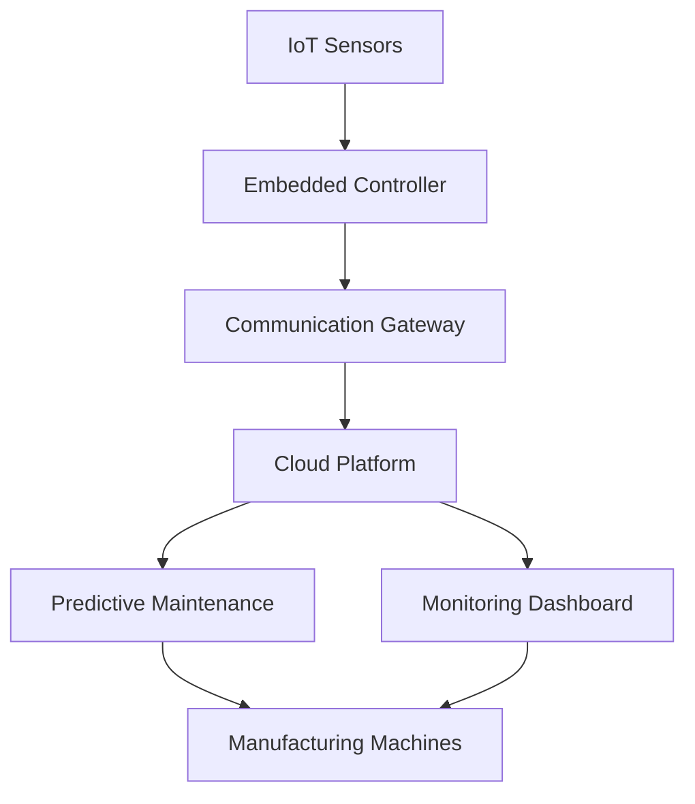

# 🌟 EXPERIMENT – 4

# Generation and Evaluation of Different Prompt Patterns Using AI Tools

## NAME: INFANCIA FELCY P
## REGISTER NUMBER:212223040067

🎯 Aim

To generate prompts using different prompting patterns, compare their outputs using different AI tools, and evaluate their effectiveness using a rubric-based evaluation method.

## 1. 🛠️ AI Tools Required

- ChatGPT
- Google Gemini
- Microsoft Copilot

## 2. 📖 Explanation

Prompt engineering is the process of designing effective instructions to obtain accurate, relevant and useful responses from AI tools.

In this experiment, seven different prompting patterns are used to solve an industrial automation problem.

The prompting techniques are:

1. Zero-Shot Prompting
2. Few-Shot Prompting
3. Chain-of-Thought Prompting
4. Persona Pattern
5. Reverse Prompting
6. Graph Prompting
7. Active Prompting

## 3. 🏭 Define the Scenario and Use Case

Scenario: Smart Manufacturing Automation Using IoT and Embedded Systems

The manufacturing industry aims to reduce manual monitoring and improve production efficiency through automation.

The proposed system uses IoT devices, sensors and embedded controllers to automate equipment, monitor machine performance and enable predictive maintenance.

Endee - AI Search and Intelligence Platform

IoT Condition Monitoring System | Predictive Maintenance & Equipment Health Monitoring

AM Automation | Montarz instalacji elektrycznych - profesjonalne usługi | Szczecin

🎯 Target Audience:

Manufacturing companies, especially in:

- Automotive industries
- Electronics industries
- Food processing industries

### Main Objectives

- ⚡ Improve production efficiency by 30%.
- 🔧 Minimize machinery downtime using predictive maintenance.
- 📡 Enable real-time monitoring and remote control.
- 🌱 Reduce energy consumption through process optimization.

## 4. 💻 Identify Prompt Patterns for Each Design Aspect

### 1️⃣ Zero-Shot Prompting

Definition: Giving an AI tool a direct instruction without providing examples.

Prompt:

Writing

Design a smart manufacturing automation system using IoT devices and embedded controllers. Explain how the system monitors machine performance, reduces downtime through predictive maintenance, enables remote monitoring and improves energy efficiency. Suggest suitable sensors, controllers and communication technologies.

Expected Output:

- IoT-based monitoring system.
- Sensor integration.
- Embedded controller selection.
- Predictive maintenance solution.
- Energy optimization methods.

### 2️⃣ Few-Shot Prompting

Definition: Providing a few examples to guide the AI in generating the expected response.

Prompt:

Writing

Consider the following examples:

Example 1: Input: Machine temperature exceeds the safe limit. Output: Generate an alert and stop the machine if necessary.

Example 2: Input: Excessive vibration is detected. Output: Identify possible bearing failure and schedule maintenance.

Example 3: Input: Energy consumption increases unexpectedly. Output: Analyze machine operation and suggest energy optimization.

Now design a smart manufacturing automation system using IoT sensors and embedded controllers. Provide similar input conditions and corresponding automated actions for temperature, vibration, energy consumption and machine performance.

Expected Output:

- Temperature monitoring and alerts.
- Vibration-based fault detection.
- Energy monitoring.
- Automated maintenance notifications.

### 3️⃣ Chain-of-Thought Prompting

Definition: Asking the AI to solve a problem through logically organized steps and explain the major stages of the solution.

Prompt:

Writing

Develop a smart manufacturing automation system using IoT and embedded controllers.

Organize the solution into the following stages:

1. Identify the manufacturing problem.
2. Select suitable IoT sensors.
3. Choose an appropriate embedded controller.
4. Design the communication architecture.
5. Explain real-time machine monitoring.
6. Develop a predictive maintenance approach.
7. Explain energy optimization.
8. Suggest system testing and performance evaluation.

Present the engineering approach in a clear, structured sequence with technical explanations.

Expected Output:

- System architecture.
- Sensor selection.
- Controller configuration.
- Communication design.
- Predictive maintenance workflow.
- Testing and validation.

### 4️⃣ Persona Pattern

Definition: Assigning a specific role or personality to the AI to generate domain-specific responses.

Prompt:

Writing

Act as a senior Industrial Automation Engineer with 10 years of experience in smart manufacturing.

Design an IoT-based industrial automation system for an automobile manufacturing company.

Explain the selection of sensors, embedded controllers, communication protocols, predictive maintenance methods and energy management techniques.

Provide a practical and cost-effective engineering solution that improves production efficiency and minimizes machine downtime.

Expected Output:

- Professional engineering recommendations.
- Industrial automation architecture.
- Suitable hardware selection.
- Practical implementation strategies.

### 5️⃣ Reverse Prompting

Definition: Asking the AI to identify the questions, requirements or information needed to construct an effective solution prompt for a given problem.

Prompt:

Writing

I want to develop a smart manufacturing automation system using IoT and embedded controllers.

Before suggesting a solution, identify the important questions that must be answered to design this system.

Consider:

1. Manufacturing equipment requirements.
2. Required sensors and actuators.
3. Embedded controller selection.
4. Communication technologies.
5. Predictive maintenance requirements.
6. Energy monitoring.
7. Safety and security.
8. Budget and scalability.

Generate a detailed set of requirement-gathering questions. Then use the identified requirements to formulate an improved engineering prompt for designing the system.

Expected Output:

- Requirement-gathering questions.
- Identification of system constraints.
- Improved engineering prompt.
- Detailed system requirements.

### 6️⃣ Graph Prompting

Definition: Using graph structures to represent relationships between different components, processes or concepts and asking AI to analyze them.

Prompt:

Writing

Represent a smart manufacturing automation system using a graph structure.

Include the following nodes:

- IoT Sensors
- Embedded Controller
- Communication Gateway
- Cloud Platform
- Monitoring Dashboard
- Predictive Maintenance System
- Manufacturing Machines

Show the relationships between these components using directed edges.

Explain the data flow from sensors to the cloud platform and how monitoring and predictive maintenance are performed.

Generate a simple Mermaid flowchart and explain each component.

Expected Output:

mermaid

- Graphical representation of system components.
- Data flow relationships.
- Machine monitoring architecture.
- Predictive maintenance connections.

### 7️⃣ Active Prompting

Definition: An interactive prompting technique in which the AI asks questions to obtain missing information and improve the final solution.

Prompt:

Writing

Act as an industrial automation consultant.

I want to develop a smart manufacturing automation system using IoT and embedded controllers.

First, ask me important questions about:

1. Type of manufacturing industry.
2. Number of machines.
3. Required sensors.
4. Preferred embedded controller.
5. Communication requirements.
6. Predictive maintenance objectives.
7. Budget limitations.

Ask the questions one by one. Based on my answers, develop a customized smart manufacturing automation solution with system architecture, hardware requirements and implementation steps.

Expected Output:

- Interactive questions.
- Requirement collection.
- Customized system design.
- Improved engineering recommendations.

## 5. 📊 Comparison of Different Prompting Patterns

| Prompt pattern | Main purpose | Expected effectiveness |
| --- | --- | --- |
| 🎯 Zero-Shot | Direct solution | Good |
| 📚 Few-Shot | Example-based solution | Very good |
| 🔄 Chain-of-Thought | Structured reasoning | Very good |
| 👨‍💻 Persona | Expert-level response | Very good |
| 🔁 Reverse | Requirement identification | Good |
| 📈 Graph | Visual relationships | Very good |
| 💬 Active | Interactive solution | Excellent |

## 6. 🧪 Procedure

1. Select a real-world engineering scenario from Unit 5.
2. Identify the problem and define the objectives.
3. Prepare prompts using all seven prompting patterns.
4. Enter the same prompts into ChatGPT, Gemini and Microsoft Copilot.
5. Collect the generated responses from each AI tool.
6. Compare the responses based on relevance, accuracy, completeness and clarity.
7. Evaluate the outputs using a rubric-based evaluation method.
8. Identify the most effective prompting pattern.

## 7. 📋 Evaluation Using Rubrics

Each AI-generated response is evaluated using five parameters.

| Evaluation criteria | Marks |
| --- | --- |
| Relevance | 5 |
| Accuracy | 5 |
| Completeness | 5 |
| Clarity | 5 |
| Practical feasibility | 5 |
| Total | 25 |

Rating Scale:

- ⭐ 1 – Poor
- ⭐⭐ 2 – Average
- ⭐⭐⭐ 3 – Good
- ⭐⭐⭐⭐ 4 – Very Good
- ⭐⭐⭐⭐⭐ 5 – Excellent

## 8. 📈 Sample Evaluation Table

The following is an illustrative evaluation, not measured results from actual tool executions.

| Prompt pattern | ChatGPT | Gemini | Copilot |
| --- | --- | --- | --- |
| Zero-Shot | 19/25 | 18/25 | 18/25 |
| Few-Shot | 22/25 | 21/25 | 20/25 |
| Chain-of-Thought | 23/25 | 22/25 | 21/25 |
| Persona | 22/25 | 22/25 | 21/25 |
| Reverse | 21/25 | 20/25 | 19/25 |
| Graph | 23/25 | 22/25 | 21/25 |
| Active | 24/25 | 23/25 | 22/25 |

## 9. 🔍 Analysis and Observations

1. Zero-Shot Prompting generates direct answers without examples.
2. Few-Shot Prompting improves response consistency by providing examples.
3. Chain-of-Thought Prompting organizes complex engineering problems into logical stages.
4. Persona Pattern produces domain-specific responses from an expert perspective.
5. Reverse Prompting helps identify missing requirements before designing a solution.
6. Graph Prompting provides a visual representation of system architecture and relationships.
7. Active Prompting improves the solution through interactive questions and answers.

🏆 Best Performing Technique: Active Prompting, as it collects additional requirements and generates a customized engineering solution.

## 10. 💡 Final Selected Prompt

Recommended final promptWriting

Act as an experienced Industrial Automation Engineer.

Design a smart manufacturing automation system using IoT devices and embedded controllers.

First, identify the system requirements by asking relevant questions. Then develop a complete engineering solution covering:

1. IoT sensor selection.
2. Embedded controller selection.
3. Communication architecture.
4. Real-time monitoring.
5. Predictive maintenance.
6. Energy optimization.
7. System architecture using a graph.
8. Implementation and testing.

The system should aim to improve production efficiency by 30%, minimize machinery downtime and reduce energy consumption.

Provide a practical, cost-effective and technically feasible solution suitable for automotive, electronics and food-processing industries.

## 11\. 🎯 Result

EXPERIMENT COMPLETED SUCCESSFULLY

The seven prompting patterns were successfully designed for the smart manufacturing automation scenario. Their purposes, expected outputs and evaluation criteria were compared using a rubric-based evaluation approach.

## 12\. 🎓 Conclusion

In this experiment, seven different prompting patterns were studied and applied to a smart manufacturing automation problem.

The experiment demonstrates that different prompting techniques produce different types of AI responses. Zero-Shot and Few-Shot Prompting are useful for direct solutions, while Chain-of-Thought, Persona, Reverse, Graph and Active Prompting help solve more complex engineering problems.

Among the techniques, Active Prompting is particularly useful for collecting requirements and developing customized solutions.

Therefore, selecting the appropriate prompting pattern improves the quality, relevance and usefulness of AI-generated engineering solutions.

✨ END OF EXPERIMENT – 04 ✨
